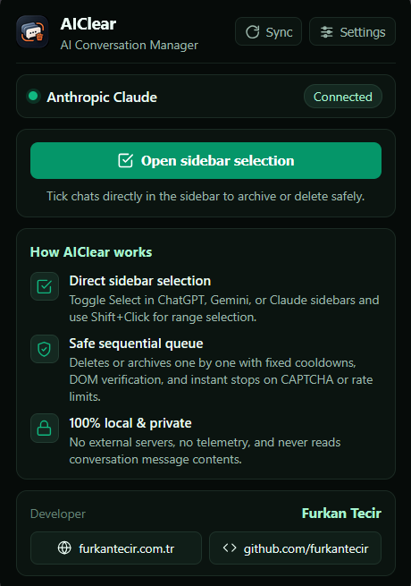
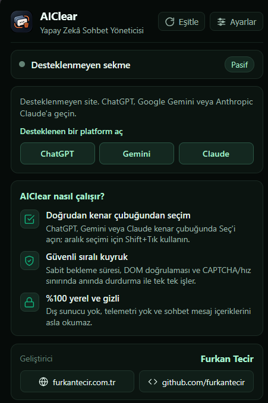
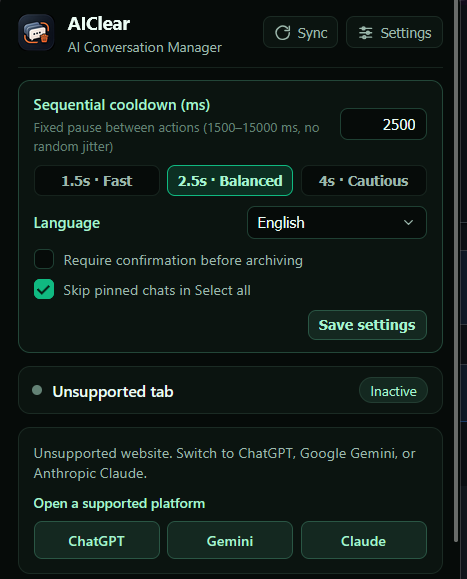
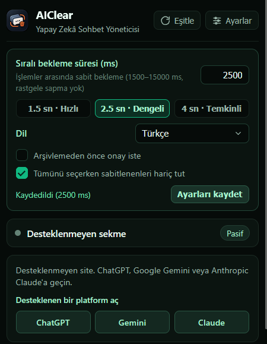
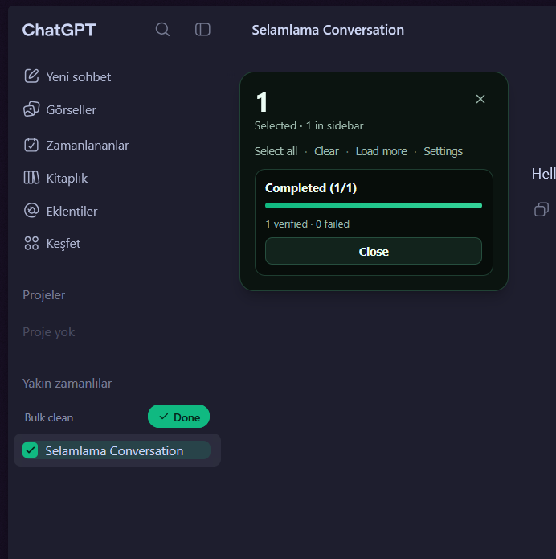
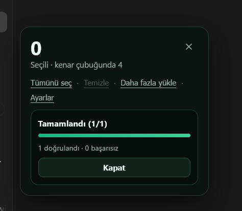

  
  <h1>AIClear</h1>
  
A 100% local Firefox extension for bulk deleting and archiving conversations across ChatGPT, Google Gemini, and Anthropic Claude directly from the sidebar.

  

    
  

  

    <a href="https://addons.mozilla.org/firefox/addon/aiclear/">Firefox Add-ons</a> ·
    <a href="PRIVACY.md">Privacy Policy</a> ·
    <a href="https://furkantecir.com.tr/">Website</a> ·
    <a href="https://github.com/furkantecir">GitHub</a>
  

## Supported Platforms

| Platform | Origin | Bulk Delete | Bulk Archive | Skip Pinned |
| --- | --- | --- | --- | --- |
| ChatGPT | `chatgpt.com` | Yes | Yes | Yes |
| Google Gemini | `gemini.google.com` | Yes | — | Yes |
| Anthropic Claude | `claude.ai` | Yes | — | Yes |

## Highlights

- **Direct Sidebar Selection:** Toggle **Select / Seç** directly above your chat list and use `Shift+Click` for range selection.
- **Sequential Safety Queue:** Processes one conversation at a time with fixed, user-selectable cooldowns (`1.5s`, `2.5s`, `4s`, or custom `1500–15000 ms`) and explicit confirmation before destructive runs.
- **Per-Item Verification & Auto-Halt:** Confirms every action completes in the page UI and stops immediately on CAPTCHA, rate limits, session expiration, or unexpected page changes, preserving remaining items.
- **Pinned Chat Protection:** Automatically skips pinned chats when clicking **Select all** (configurable in Settings).
- **100% Local & Private:** Zero external network calls, zero telemetry, and never reads conversation message bodies.
- **Bilingual UI:** Full English and Turkish (`Türkçe`) support.

## Screenshots / Ekran Görüntüleri

<table align="center">
  <tr>
    <td align="center" width="50%">
      
       
      <strong>Extension Popup (EN)</strong>
    </td>
    <td align="center" width="50%">
      
       
      <strong>Eklenti Penceresi (TR)</strong>
    </td>
  </tr>
  <tr>
    <td align="center" width="50%">
      
       
      <strong>Settings &amp; Speed Presets (EN)</strong>
    </td>
    <td align="center" width="50%">
      
       
      <strong>Ayarlar ve Hız Seçenekleri (TR)</strong>
    </td>
  </tr>
  <tr>
    <td align="center" width="50%">
      
       
      <strong>Sidebar Selection &amp; Floating Card (EN)</strong>
    </td>
    <td align="center" width="50%">
      
       
      <strong>Yüzen Kontrol Kartı (TR)</strong>
    </td>
  </tr>
</table>

## Türkçe Özet

- **Doğrudan kenar çubuğundan seçim:** ChatGPT, Google Gemini ve Anthropic Claude kenar çubuklarında **Seç** butonunu açın; `Shift+Tık` ile aralık seçimi yapın.
- **Güvenli sıralı işlem:** Her sohbeti sabit bekleme süreleriyle (`1.5 sn`, `2.5 sn`, `4 sn`) tek tek işler, her adımı doğrular ve CAPTCHA, hız sınırı veya oturum kaybında işlemi anında durdurur.
- **Sabitlenenleri koruma:** **Tümünü seç** sırasında sabitlenmiş sohbetleri varsayılan olarak hariç tutar.
- **Tamamen yerel:** Dış sunucu veya telemetri içermez; sohbet mesaj içeriklerini asla okumaz.

---

  Developed by <strong>Furkan Tecir</strong> · <a href="https://furkantecir.com.tr/">furkantecir.com.tr</a> · <a href="https://github.com/furkantecir">github.com/furkantecir</a>

